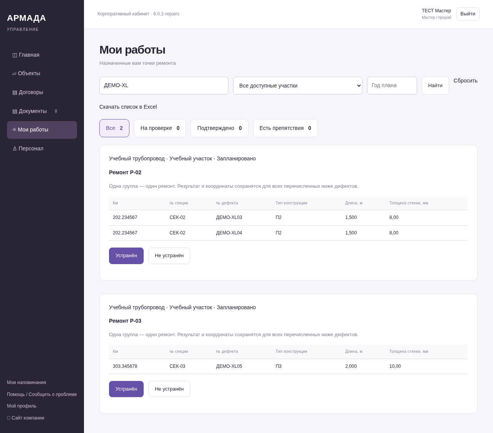
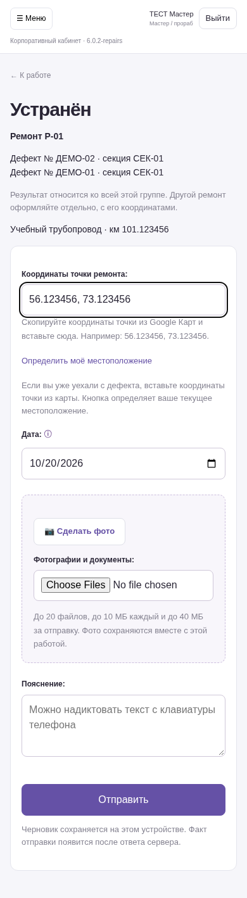
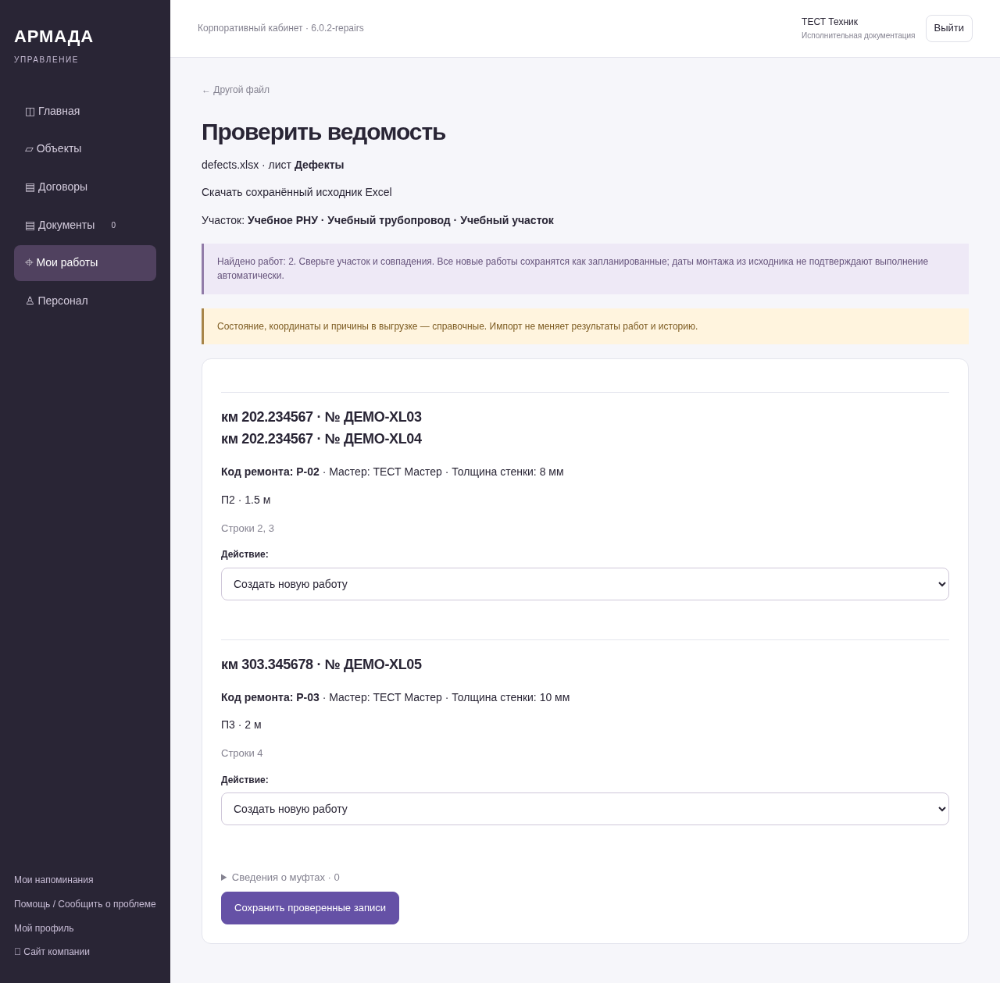
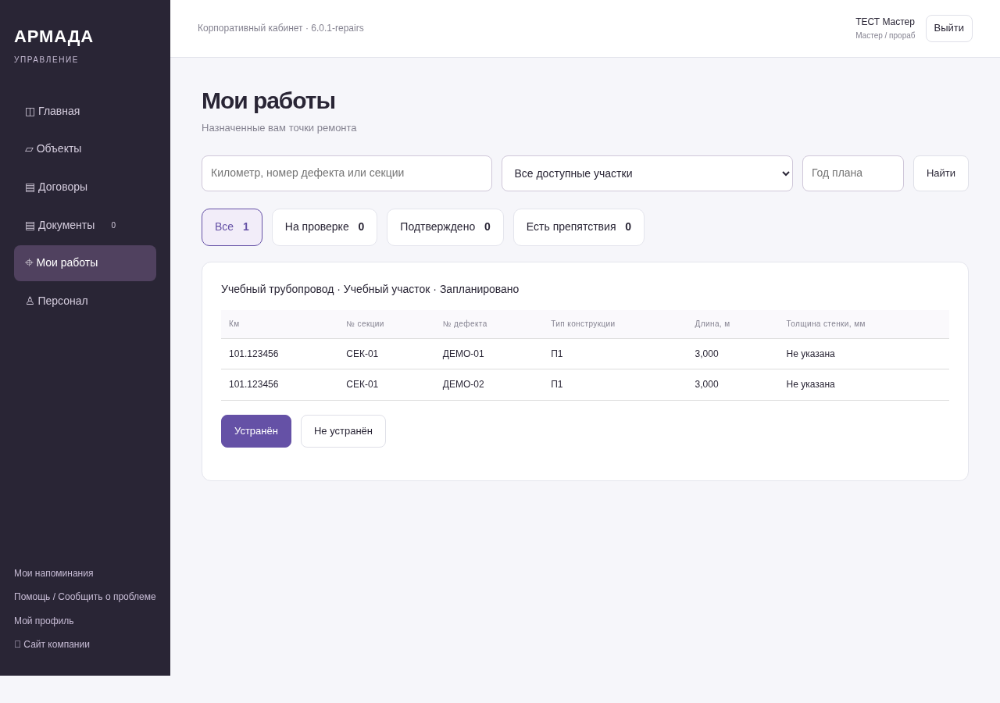
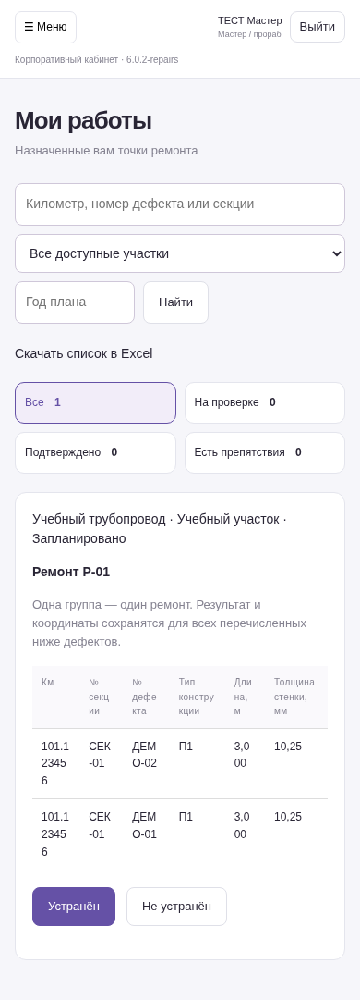
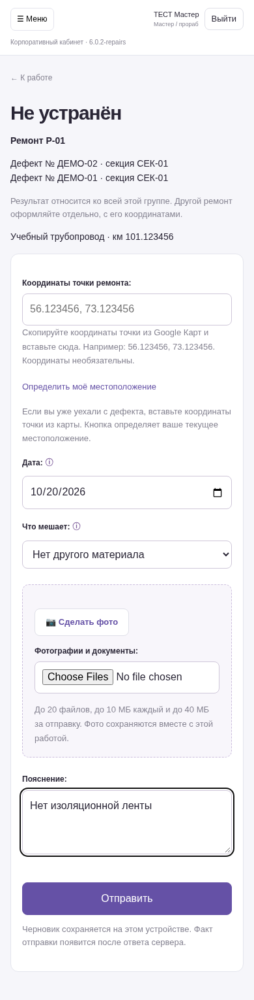
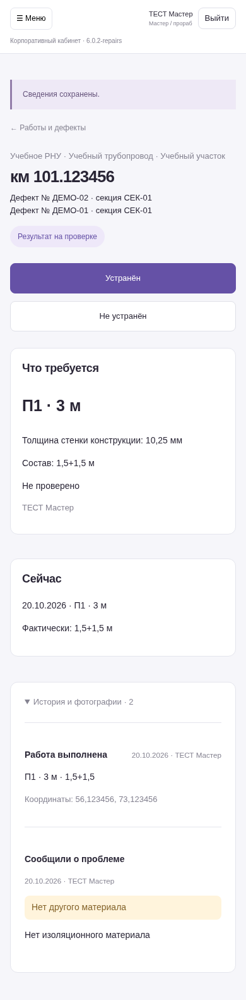

Зелёный — устранён; красный — нет доступа; жёлтый — нет материалов.

# Пакет обновления NAS 6.0.7

[Скачать полный архив для NAS](openIA-NAS-6.0.7.zip) — 16 МБ.

[SHA-256 архива](openIA-NAS-6.0.7.sha256).

В архиве полный код версии 6.0.7, Docker Compose, зависимости с проверяемыми хешами.
Корневая папка: `openIA-feature-accounts-foundation`. Обновление предназначено для
существующего проекта `armada-test` на Synology x86_64. Тома и локальные настройки
сохраняются. Подготовка архива не выполняет установку на NAS.

---

Зелёный — устранён; красный — нет доступа; жёлтый — нет материалов.

# Пакет обновления NAS 6.0.6

[Скачать полный архив для NAS](openIA-NAS-6.0.6.zip) — 16 МБ.

[SHA-256 архива](openIA-NAS-6.0.6.sha256).

В архиве полный код версии 6.0.6, Docker Compose, зависимости с проверяемыми хешами.
Корневая папка: `openIA-feature-accounts-foundation`. Обновление предназначено для
существующего проекта `armada-test` на Synology x86_64. Тома и локальные настройки
сохраняются. Подготовка архива не выполняет установку на NAS.

---

[Посмотреть обновлённую таблицу дефектов](10-register-terms.png)

# Пакет обновления NAS 6.0.5

[Скачать полный архив для NAS](openIA-NAS-6.0.5.zip) — 16 МБ.

[SHA-256 архива](openIA-NAS-6.0.5.sha256).

В архиве полный код версии 6.0.5, Docker Compose, зависимости с проверяемыми хешами.
Корневая папка: `openIA-feature-accounts-foundation`. Обновление предназначено для
существующего проекта `armada-test` на Synology x86_64. Тома и локальные настройки
сохраняются. Подготовка архива не выполняет установку на NAS.

---

[Посмотреть компактную таблицу дефектов](09-compact-register.png)

# Пакет обновления NAS 6.0.4

[Скачать полный архив для NAS](openIA-NAS-6.0.4.zip) — 16 МБ.

[SHA-256 архива](openIA-NAS-6.0.4.sha256).

В архиве полный код версии 6.0.4, Docker Compose, зависимости с проверяемыми хешами.
Корневая папка: `openIA-feature-accounts-foundation`. Обновление предназначено для
существующего проекта `armada-test` на Synology x86_64. Тома и локальные настройки
сохраняются. Подготовка архива не выполняет установку на NAS.

---

# Пакет обновления NAS 6.0.3

[Скачать полный архив для NAS](openIA-NAS-6.0.3.zip) — 16 МБ.

[SHA-256 архива](openIA-NAS-6.0.3.sha256).

В архиве полный код версии 6.0.3, Docker Compose, зависимости с проверяемыми хешами.
Корневая папка: `openIA-feature-accounts-foundation`. Обновление предназначено для
существующего проекта `armada-test` на Synology x86_64. Тома и локальные настройки
сохраняются. Подготовка архива не выполняет установку на NAS.

---

# Пакет обновления NAS 6.0.3

[Скачать полный архив для NAS](openIA-NAS-6.0.3.zip) — 16 МБ.

[SHA-256 архива](openIA-NAS-6.0.3.sha256).

В архиве полный код версии 6.0.3, Docker Compose, зависимости с проверяемыми хешами.
Корневая папка: `openIA-feature-accounts-foundation`. Обновление предназначено для
существующего проекта `armada-test` на Synology x86_64. Тома и локальные настройки
сохраняются. Подготовка архива не выполняет установку на NAS.

---

# Пакет обновления NAS 6.0.2

[Скачать полный архив для NAS](openIA-NAS-6.0.2.zip) — 16 МБ.

[SHA-256 архива](openIA-NAS-6.0.2.sha256).

В архиве полный код версии 6.0.2, Docker Compose, зависимости с проверяемыми хешами.
Корневая папка: `openIA-feature-accounts-foundation`. Обновление предназначено для
существующего проекта `armada-test` на Synology x86_64. Тома и локальные настройки
сохраняются. Подготовка архива не выполняет установку на NAS.

---

# openIA 6.0.2 — кабинет мастера и Excel

Все снимки сделаны в работающем тестовом кабинете на вымышленных данных.

- [Скачать снимки и Excel одним архивом](openIA-interface-6.0.2.zip)
- [Пустой шаблон Excel](openIA-template.xlsx)
- [Пример: два ремонта, три дефекта](openIA-example.xlsx)

В примере Р-02 включает два дефекта на км 202.234567 под одной конструкцией.
Р-03 — отдельный ремонт на км 303.345678, со своими координатами.
Телефон +70000000003 учебный: замените его на телефон мастера в вашей системе
либо оставьте пустым и назначьте мастера после загрузки. Мастер должен заранее
иметь доступ к объекту. Один файл загружается в выбранный участок.

Группы заранее задаёт техник полем «Код ремонта». Мастер открывает нужную группу
и отправляет результат для всех её дефектов. Два разных ремонта оформляются отдельно.

Координаты копируются из Google Карт одной строкой: `56.123456, 73.123456`.
Находиться на дефекте для этого не нужно. Кнопка геолокации определяет текущее
местоположение телефона и используется только при нахождении на нужной точке.

Импорт/назначение: руководители и сотрудники с отдельно выданным правом подготовки
ведомостей и доступом к объекту. Подтверждение выполнения остаётся руководителю.
Экспорт содержит только доступные пользователю строки и учитывает фильтры.

## Два отдельных ремонта

## Одно поле координат

## Проверка Excel перед сохранением

## Первоначальная группа: два дефекта

## На телефоне

## Не устранён

## История

Материалы относятся к подготовленному обновлению 6.0.2. Эта ветка содержит только
снимки и примеры для просмотра. Код обновления и рабочая установка не публиковались.
NAS не изменён.
