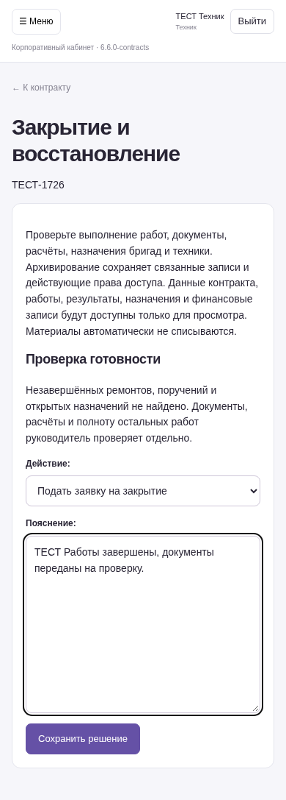
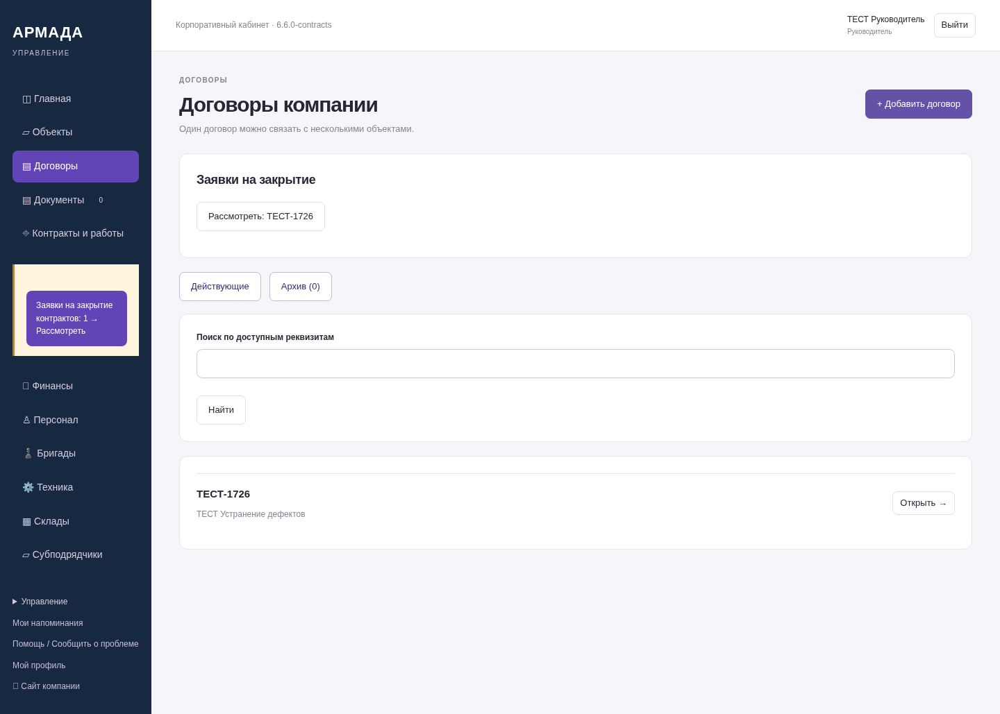
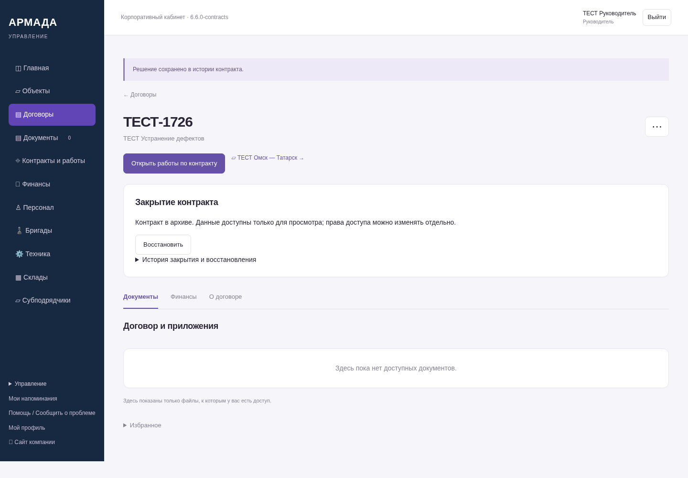

# Закрытие и архив контрактов — 6.6.0-contracts

Снимки работающей программы на вымышленных данных. Это серверные формы и реальные переходы, не макеты. NAS не обновлялся.

[Описание и границы автоматической проверки](https://github.com/zolotojmiha-ctrl/openIA/blob/ec7486e678590c00a8f3f6a67b51517638be4eda/CONTRACT_CLOSURE.md)

[Результаты проверки](https://github.com/zolotojmiha-ctrl/openIA/blob/ec7486e678590c00a8f3f6a67b51517638be4eda/CONTRACT_CLOSURE_VALIDATION.md)

Пройдены 363 проверки PostgreSQL и все 8 браузерных сценариев. После заключительных правок интерфейса дополнительно пройдены 19 проверок, включая три браузерных сценария.

## Заявка техника с телефона

## Очередь заявок руководителя

## Архив и история решений

Документы, расчёты и полноту иных работ руководитель проверяет отдельно. Архивирование не списывает материалы и не закрывает назначения автоматически. Права доступа сохранены; их можно отзывать отдельно.
