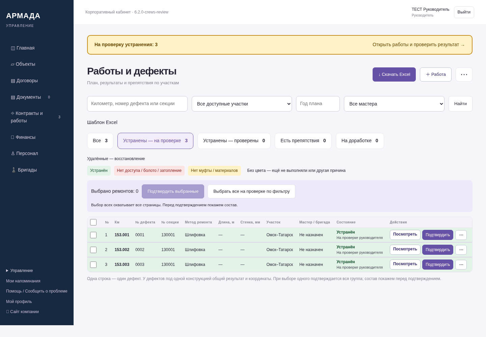
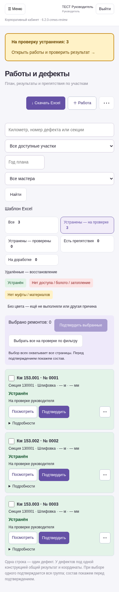
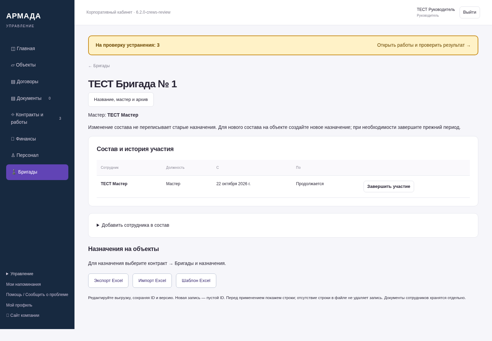
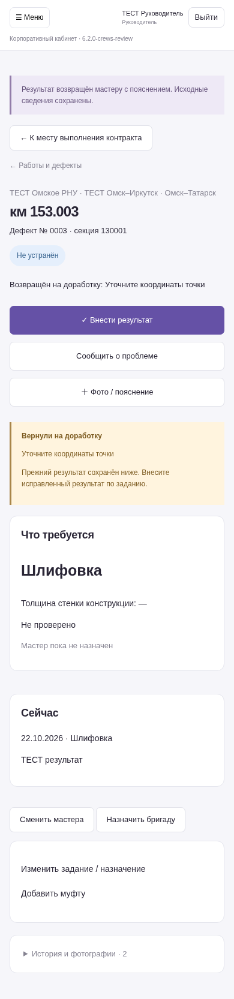

# Второй этап ЛК — 6.2.0-crews-review

Снимки работающей программы на синтетических данных. Это не графические макеты.
NAS не обновлялся. Остальные согласованные функции остаются в следующих этапах.

[Что реализовано и что остаётся](https://github.com/zolotojmiha-ctrl/openIA/blob/924a427c3fed9d82474cd33fb4ac52a7bddfb696/CREWS_REVIEW_6_2.md)

[Результаты проверок](https://github.com/zolotojmiha-ctrl/openIA/blob/924a427c3fed9d82474cd33fb4ac52a7bddfb696/CREWS_REVIEW_6_2_VALIDATION.md)

## Компактная таблица и отдельное подтверждение руководителем

## Телефон: действия без смахивания таблицы

## Реальная бригада с датами и историей

## Возврат на доработку с сохранением исходных сведений

