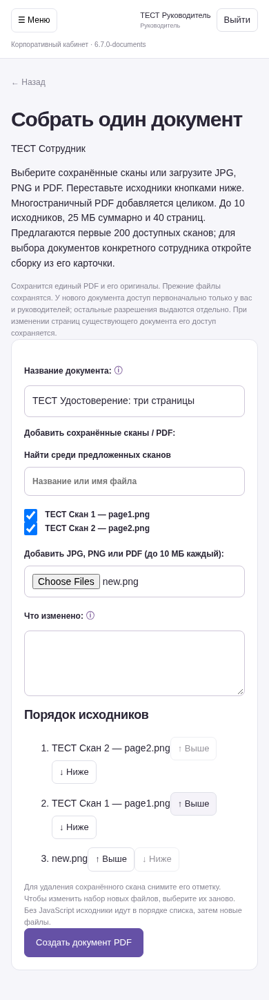
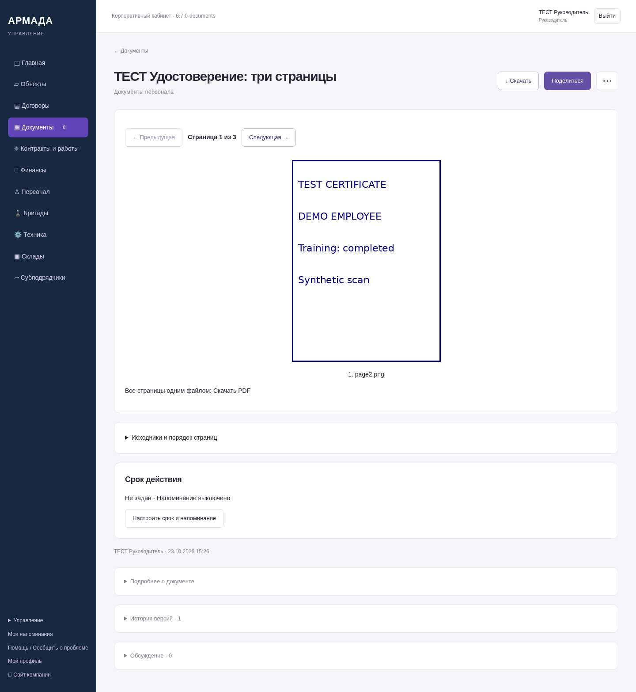
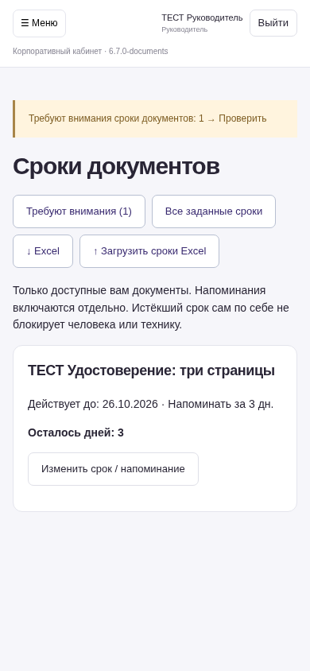
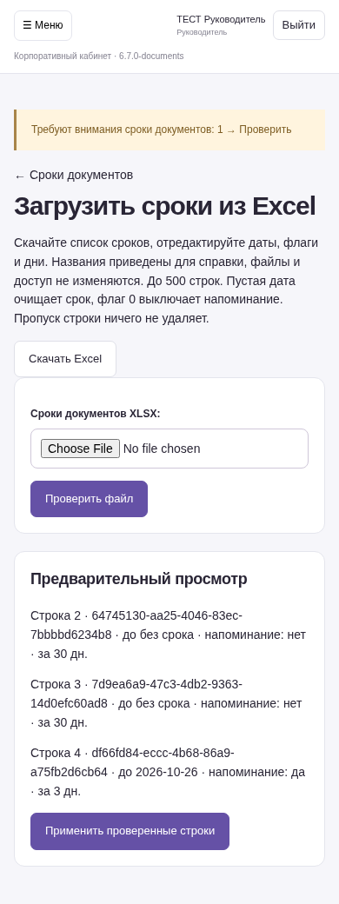

# Документы и сроки — 6.7.0-documents

Реальные экраны серверного приложения на вымышленных данных. Это не макеты. NAS не обновлялся.

[Порядок работы и ограничения](https://github.com/zolotojmiha-ctrl/openIA/blob/9c4f01bb7c7114b23d481049cd8035c0e0eeed7e/DOCUMENTS_6_7.md)

[Проверки](https://github.com/zolotojmiha-ctrl/openIA/blob/9c4f01bb7c7114b23d481049cd8035c0e0eeed7e/DOCUMENTS_6_7_VALIDATION.md)

385 тестов PostgreSQL и 9 браузерных сценариев прошли. Просмотрщик проверен по фактической загрузке изображения и переключению страниц.

## Собрать документ из сохранённых сканов и новых файлов

## Один документ, листание сканов и единый PDF для скачивания

## Напоминания только при включённом параметре и в пределах доступа

## Excel: проверка сроков перед применением

Оригиналы и история сохраняются. Права нового документа задаются отдельно. Поддерживаются JPG, PNG и PDF; подробные лимиты — в описании. Уведомления в этом этапе отображаются внутри ЛК.
