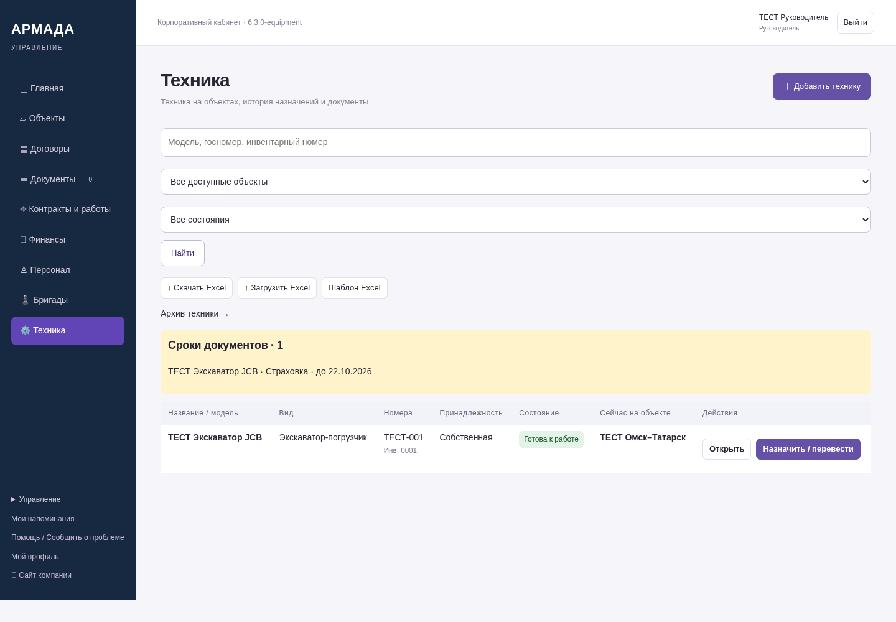
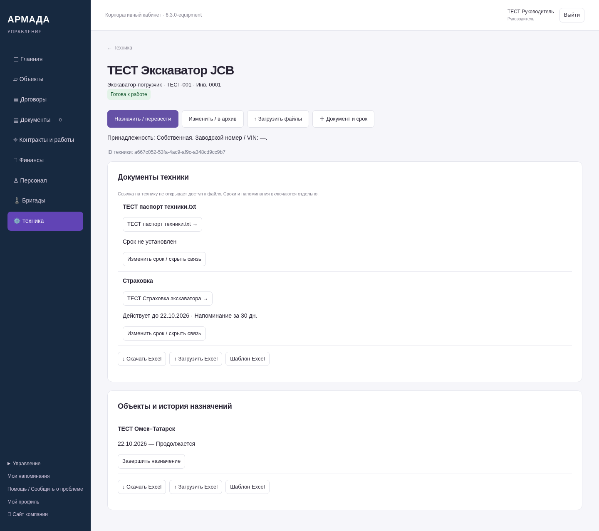
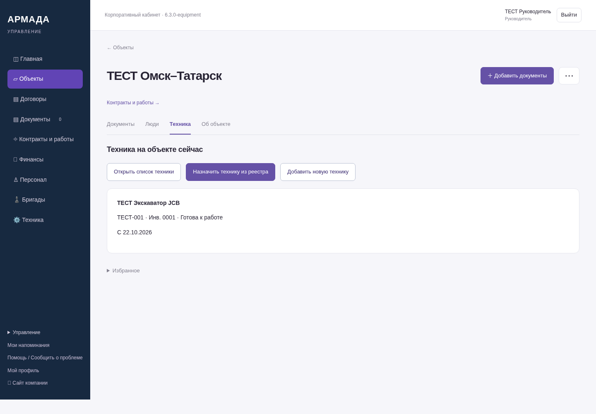
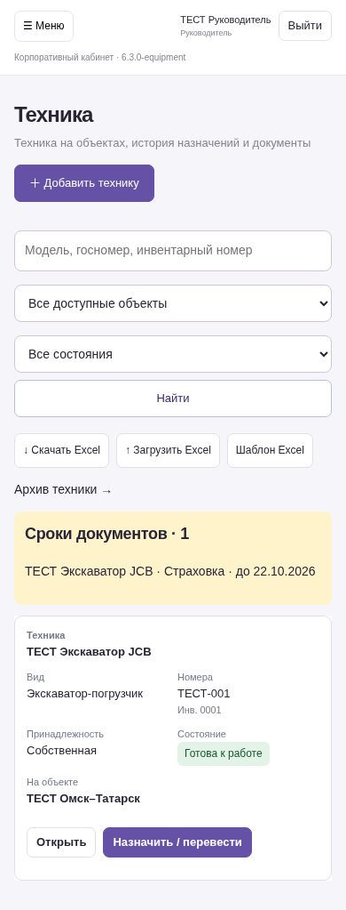

# Третий этап ЛК — 6.3.0-equipment

Снимки работающего серверного приложения на синтетических данных, не графические макеты.
NAS не обновлялся. Остальные согласованные функции остаются в следующих этапах.

[Что реализовано и как пользоваться](https://github.com/zolotojmiha-ctrl/openIA/blob/418d0bf0a59475760e50596c1d982f7ea88a7f6a/EQUIPMENT_6_3.md)

[Проверки](https://github.com/zolotojmiha-ctrl/openIA/blob/418d0bf0a59475760e50596c1d982f7ea88a7f6a/EQUIPMENT_6_3_VALIDATION.md)

## Реестр техники на компьютере

## Карточка с документами и историей назначений

## Техника в карточке объекта

## Телефон

