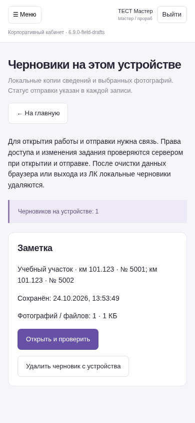

# Черновики на устройстве — 6.9.0-field-drafts

Реальный экран приложения на вымышленных данных. NAS не обновлялся.

[Как работает и какие есть ограничения](https://github.com/zolotojmiha-ctrl/openIA/blob/60c0d00ff3e22d5bb5e6febc11b41b76a8e36003/FIELD_DRAFTS_6_9.md) · [Проверки](https://github.com/zolotojmiha-ctrl/openIA/blob/60c0d00ff3e22d5bb5e6febc11b41b76a8e36003/FIELD_DRAFTS_6_9_VALIDATION.md)

Черновик с фотографией сохранён без связи, найден в общем списке и восстановлен в форме. Потеря ответа сервера проверена реальным запросом: повторная отправка создаёт только одну запись. Для входа, открытия формы после перезагрузки и отправки нужна связь. Полный автономный режим этот этап не заявляет.
