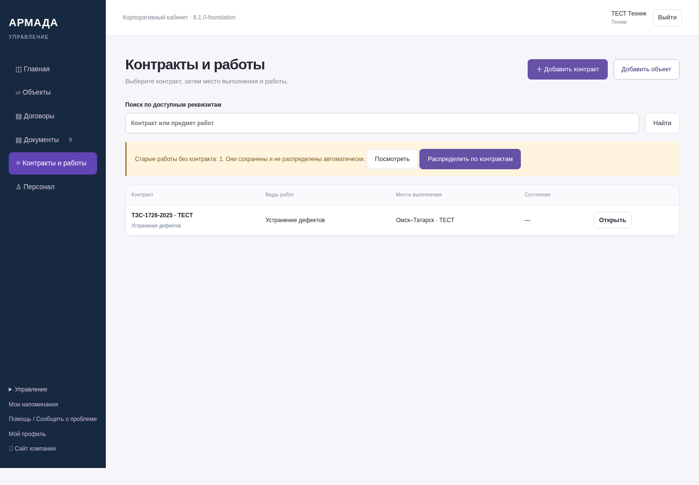
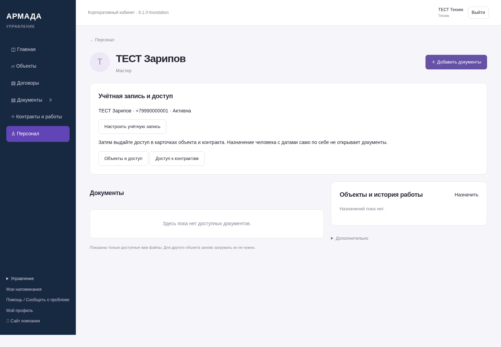
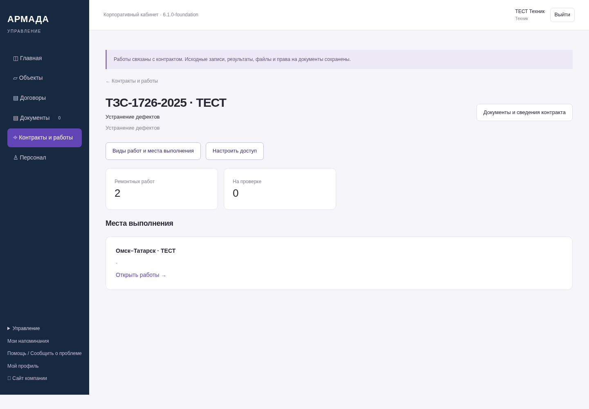
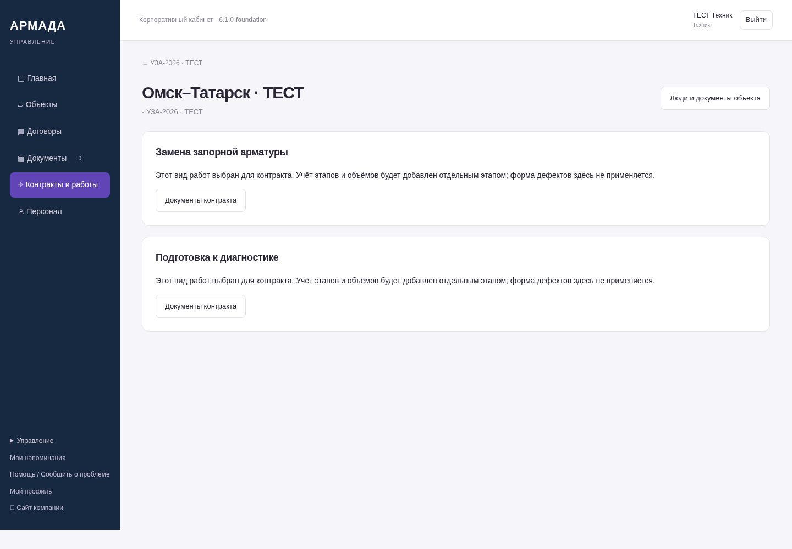
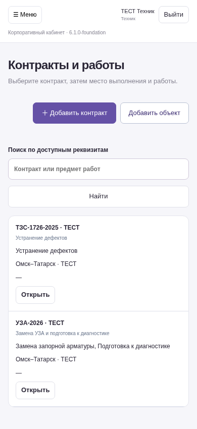

# Первый этап ЛК — 6.1.0-foundation

Это снимки работающего серверного приложения на синтетических данных, не графические макеты.
NAS не обновлён. Реализован только первый этап, остальные согласованные функции не отменены.

[Описание готового этапа и его границ](https://github.com/zolotojmiha-ctrl/openIA/blob/a256feabc678eaf898fff8f797da5ad136a27c3d/FOUNDATION_6_1.md)

[Проверки](https://github.com/zolotojmiha-ctrl/openIA/blob/a256feabc678eaf898fff8f797da5ad136a27c3d/FOUNDATION_6_1_VALIDATION.md)

[Исходный код](https://github.com/zolotojmiha-ctrl/openIA/tree/a256feabc678eaf898fff8f797da5ad136a27c3d)

## Контракты и работы

## Сотрудник, учётная запись и отдельные доступы

## Контракт и места выполнения

## Выбор других видов работ

Производственный учёт УЗА и подготовки к диагностике относится к следующему этапу.
Здесь уже выбирается правильный вид работ; вместо неподходящей формы дефектов показана явная граница этапа.

## Телефон — список контрактов

