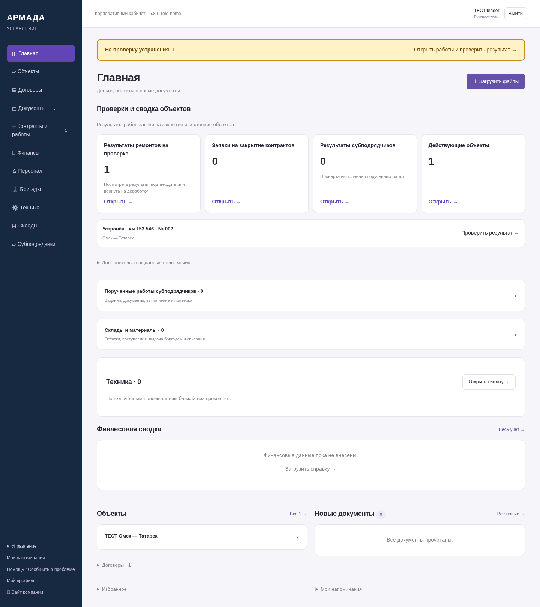
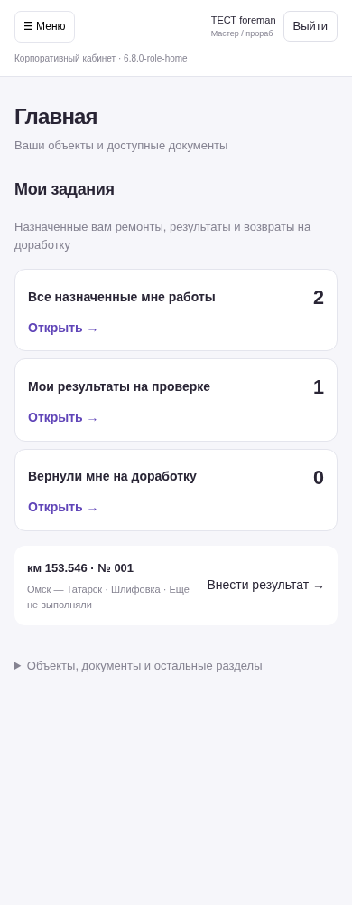
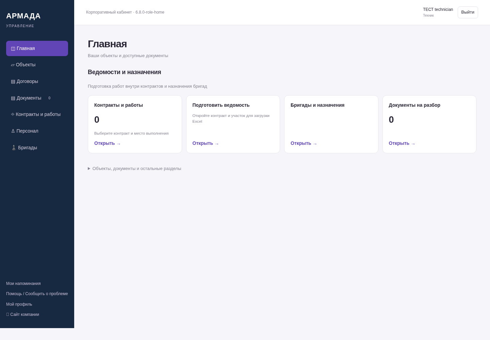
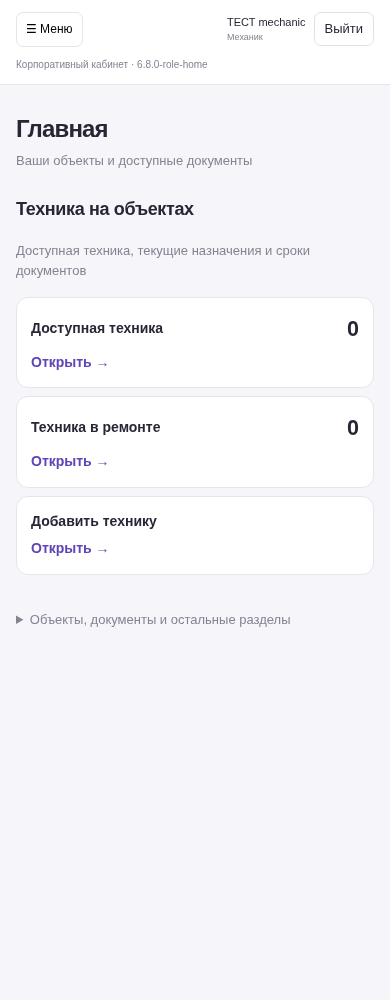
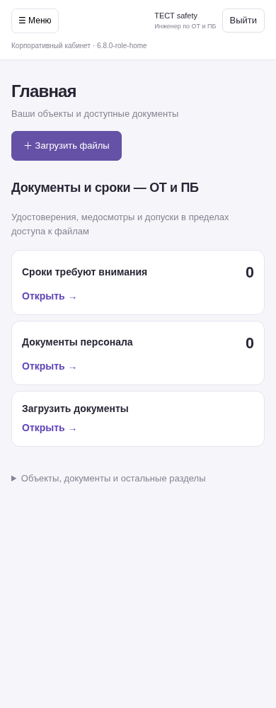
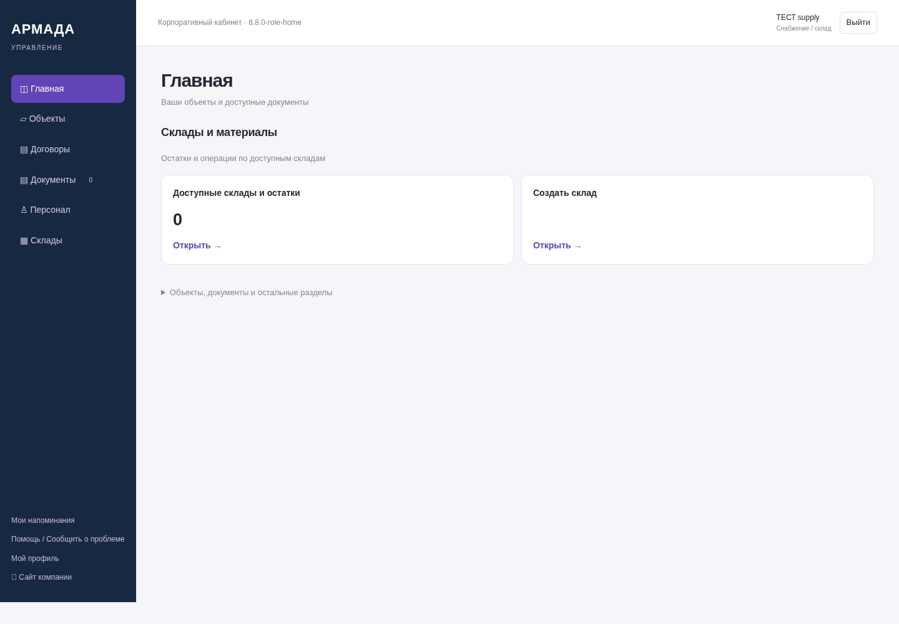

# Стартовые экраны по должностям — 6.8.0-role-home

Реальные экраны приложения на вымышленных данных. NAS не обновлялся.

[Функции и границы этапа](https://github.com/zolotojmiha-ctrl/openIA/blob/f2c1aec899733476298a8ff13c98d4f85b8e2721/ROLE_HOME_6_8.md) · [Проверки](https://github.com/zolotojmiha-ctrl/openIA/blob/f2c1aec899733476298a8ff13c98d4f85b8e2721/ROLE_HOME_6_8_VALIDATION.md)

## Руководитель — результаты на проверке и сводка

## Мастер — только свои задания, с телефона

## Техник — ведомости и назначения

## Механик — техника и размещения

## Инженер по ОТ и ПБ — документы и сроки

## Снабжение — склады и материалы

Счётчики и действия получены с сервера. Должность не расширяет права. Общие разделы и дополнительно выданные полномочия сохранены. Примеры пустых разделов показывают состояние до внесения данных.
