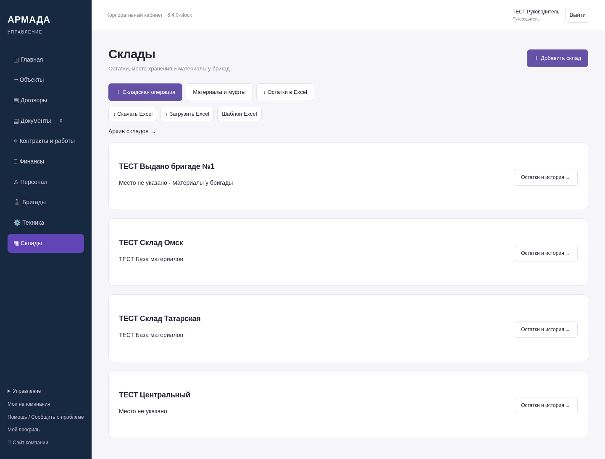
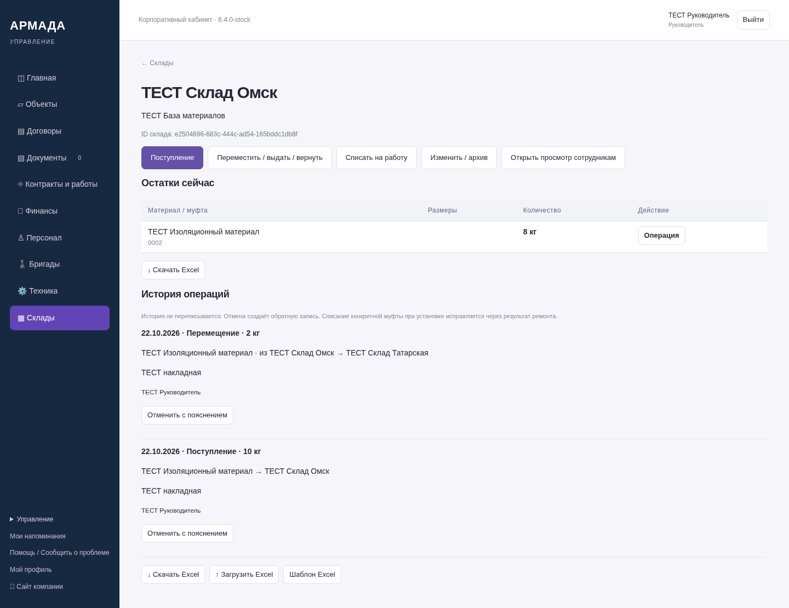
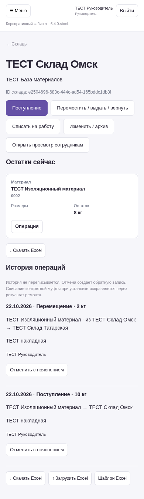
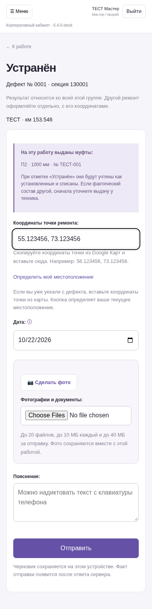
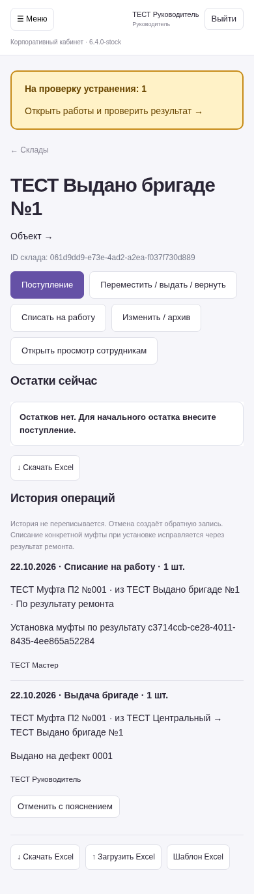

# Четвёртый этап ЛК — 6.4.0-stock

Снимки работающего серверного приложения на синтетических данных, не макеты.
NAS не обновлялся. Остальные согласованные функции остаются в следующих этапах.

[Готовые функции и порядок работы](https://github.com/zolotojmiha-ctrl/openIA/blob/964346c495677ff47d0bad7db06fe11f1c6d583d/STOCK_6_4.md)

[Проверки](https://github.com/zolotojmiha-ctrl/openIA/blob/964346c495677ff47d0bad7db06fe11f1c6d583d/STOCK_6_4_VALIDATION.md)

## Склады и места хранения у бригад

## Остатки и история

## Телефон

## Выданная на работу муфта в простой форме мастера

## Автоматическое списание после сохранения установки

