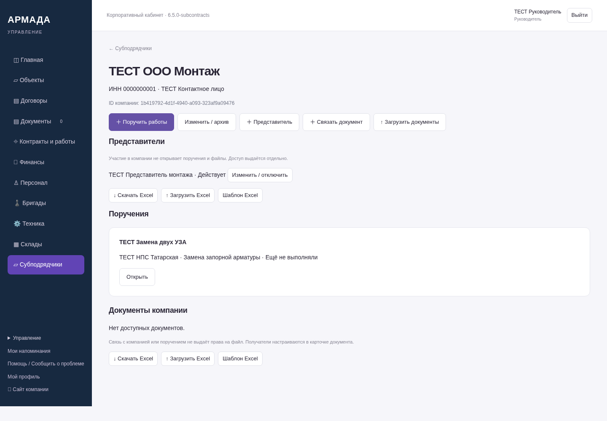
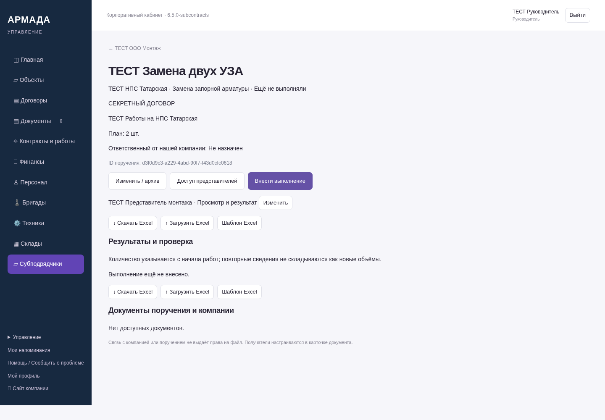
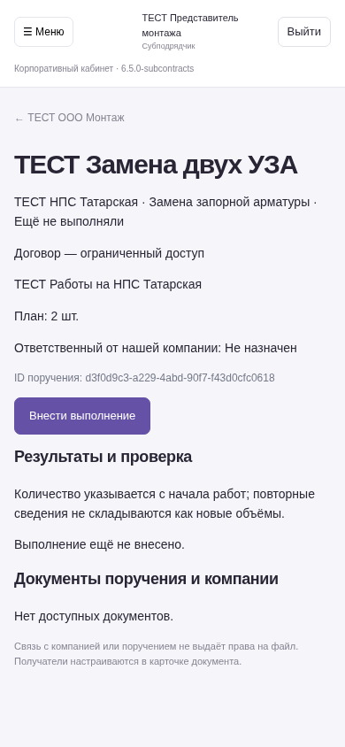
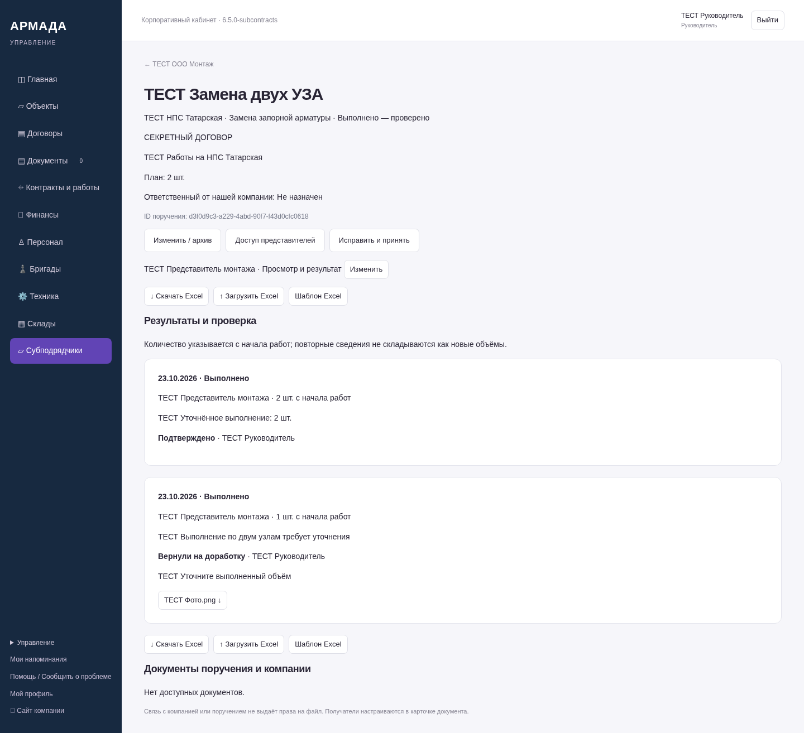

# Пятый этап ЛК — 6.5.0-subcontracts

Снимки работающего серверного приложения на синтетических данных, не макеты.
NAS не обновлялся. Остальные согласованные функции остаются в следующих этапах.

[Готовые функции, права и порядок работы](https://github.com/zolotojmiha-ctrl/openIA/blob/b5fcf9ebe0b2a6a65aa57fcd435e192434700f1d/SUBCONTRACTS_6_5.md)

[Проверки](https://github.com/zolotojmiha-ctrl/openIA/blob/b5fcf9ebe0b2a6a65aa57fcd435e192434700f1d/SUBCONTRACTS_6_5_VALIDATION.md)

## Компания и представители

## Конкретное поручение и отдельный доступ

## Телефон представителя: только его поручение, закрытые поля договора сохранены

## Возврат, повторная сдача, подтверждение и история

